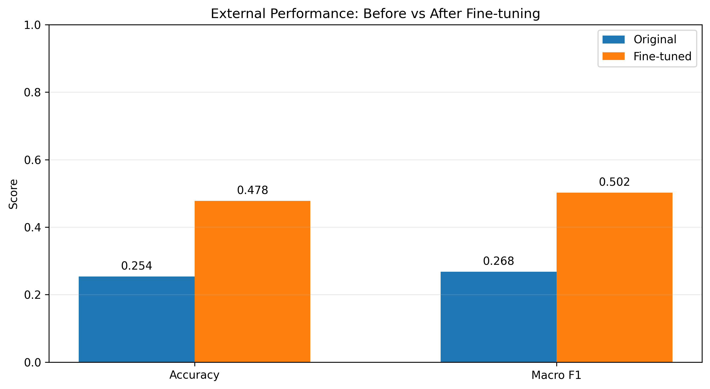
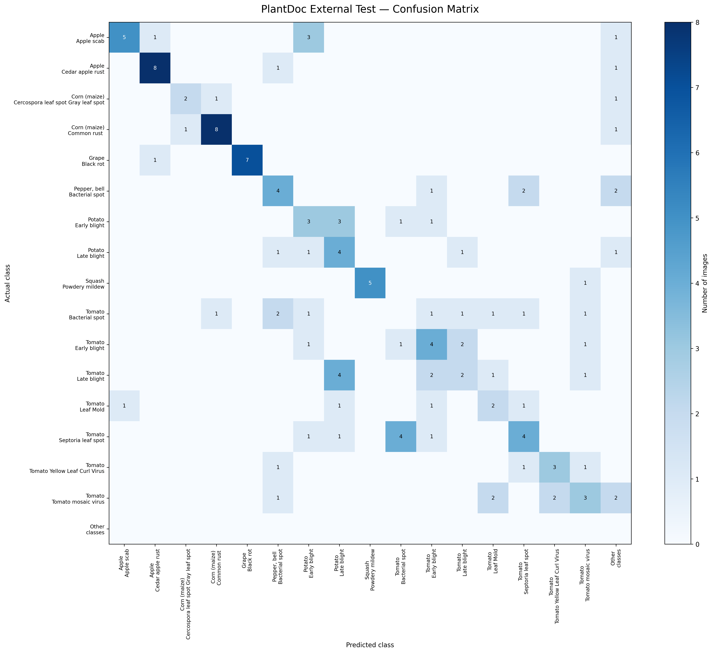
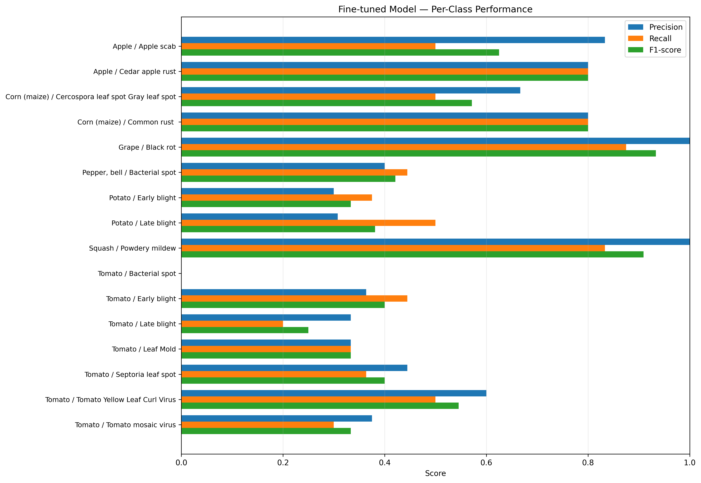
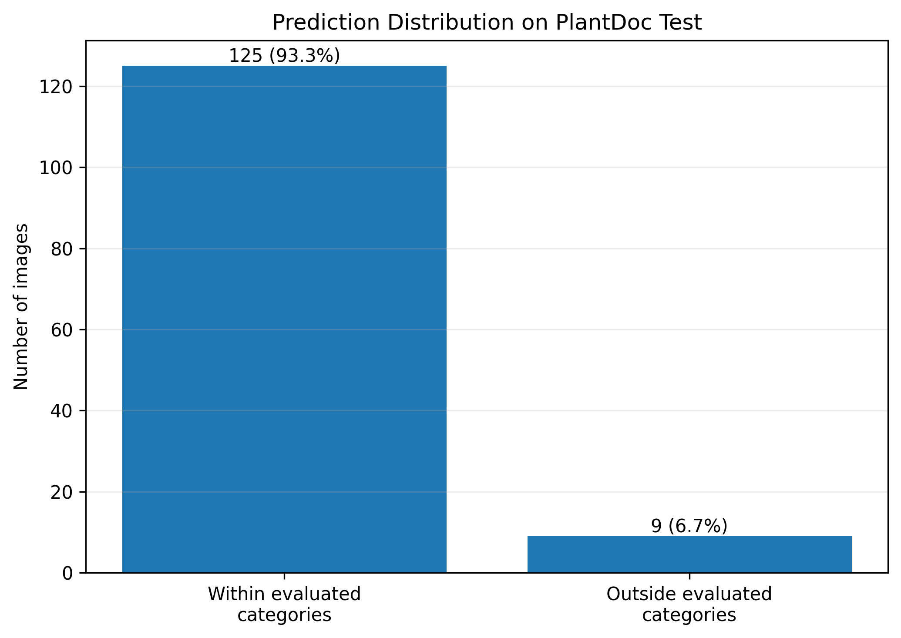

# CeryS Plant Disease Research

An experimental plant disease classification project developed for CeryS AI using PyTorch and EfficientNet-B3.

The experiment studies the gap between controlled-dataset performance and performance on external leaf photographs. It includes PlantVillage training, PlantDoc fine-tuning, quantitative evaluation, visualizations and documented prediction failures.

## Repository contents

- **[Main Colab notebook](CeryS_Plant_Disease_Model_v1.ipynb)** — end-to-end training and evaluation record.
- **[Model checkpoints](models/)** — initial, fine-tuned and packaged checkpoints.
- **[Evaluation results](evaluation_results.json)** — PlantVillage metrics and class-level report.
- **[Visualizations](cerys_visualizations/)** — performance comparison, confusion matrix, class-wise scores and prediction distribution.
- **[Methodology](docs/methodology.md)** — datasets, splits, training and evaluation procedure.
- **[Failure analysis](docs/failure-analysis.md)** — external image tests and prediction outputs.
- **[Limitations](docs/limitations.md)** — known constraints and deployment status.
- **[External test log](results/external-tests/README.md)** — qualitative test register.
- **[Dependencies](requirements.txt)** — Python packages used by the project.

## Model

**CeryS EfficientNet-B3 — Experimental v1**

| Property | Value |
|---|---|
| Architecture | EfficientNet-B3 |
| Output classes | 38 |
| Input resolution | 224 × 224 |
| Initial training data | PlantVillage |
| Fine-tuning data | PlantDoc training split |
| Framework | PyTorch |

## Evaluation results

| Dataset / stage | Images | Accuracy | Macro F1 |
|---|---:|---:|---:|
| PlantVillage held-out test split | 8,147 | **99.82%** | **0.9973** |
| PlantDoc strict subset, before fine-tuning | 134 | **25.37%** | **0.2678** |
| PlantDoc strict subset, after fine-tuning | 134 | **47.76%** | **0.5023** |

PlantDoc fine-tuning used 1,400 training images from 16 mapped disease categories, split into 80% training and 20% validation. The same 134-image PlantDoc test subset was used for the before/after comparison and was not used for gradient updates or checkpoint selection.

The PlantVillage split was image-level, not documented as plant- or source-independent. Its high score should not be interpreted as field accuracy. Read the [methodology](docs/methodology.md) and [limitations](docs/limitations.md) before interpreting these results.

## Visualizations

### External performance comparison



### PlantDoc confusion matrix



### Per-class metrics



### Prediction distribution



## External photograph checks

Two manually selected Google Images / web photograph checks exposed failure cases. One image's reference label was uncertain and may show grape erineum mite, a condition outside the model's taxonomy. A second documented grape black rot photograph was incorrectly classified as Apple Cedar Rust with a 65.50% score; Grape Black Rot did not appear in the top three.

These qualitative checks are not part of the PlantDoc benchmark and are not used to calculate accuracy. Full outputs and interpretation are recorded in [failure analysis](docs/failure-analysis.md).

## Limitations and status

**Experimental research prototype — not production-ready.**

- PlantVillage performance does not establish field reliability.
- PlantDoc external evaluation covers only 134 images and 16 mapped categories.
- The model retains 38 outputs, including classes not represented in the strict PlantDoc subset.
- The classifier has no dedicated unknown / unsupported-condition output.
- Softmax scores are not calibrated diagnostic probabilities.
- External photographs have already exposed confident crop/disease misclassifications.
- Broader expert-labelled field validation is required before any diagnostic deployment.

The existing CeryS AI production disease-detection path remains separate from this experimental checkpoint.

## Reproducing the environment

Install dependencies:

```bash
pip install -r requirements.txt
```

Open the notebook in Google Colab and follow its cells in order. Dataset download and setup instructions are recorded in the notebook. Checkpoint files are available under [models/](models/).

## Dataset acknowledgement

This project uses PlantVillage and PlantDoc. Consult the original dataset repositories and their terms before downloading, redistributing or reusing the data:

- [PlantVillage dataset repository](https://github.com/spMohanty/PlantVillage-Dataset)
- [PlantDoc dataset repository](https://github.com/pratikkayal/PlantDoc-Dataset)

